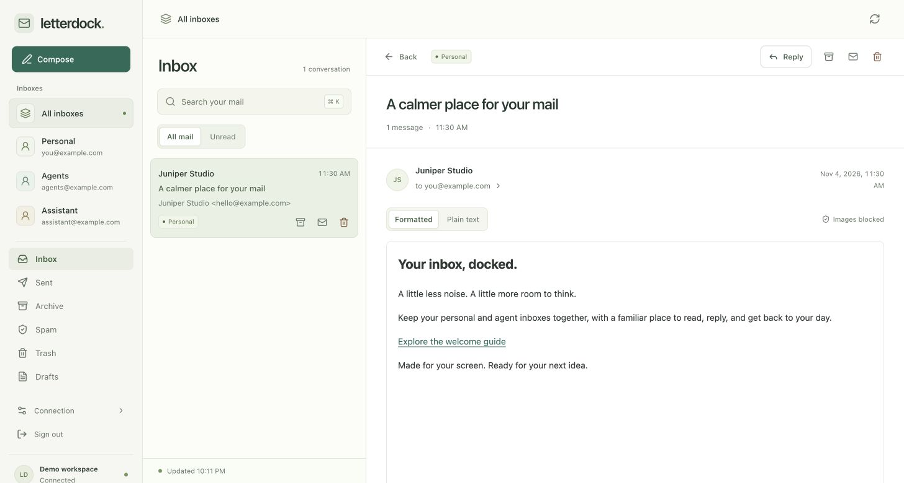

# Letterdock

**A calm home for your Resend inboxes.**

A self-hosted email app for [Resend Inboxes](https://resend.com/products/inboxes/), with a responsive interface for your computer and phone. Bring your own Resend account, keep the API key on your server, and manage your mail in one place.

[](https://github.com/Bennyyy28/letterdock/actions/workflows/ci.yml)
[](LICENSE)



*Desktop preview with synthetic mail. [See the mobile view](docs/preview-mobile.jpg).*

## What you can do

- Bring up to ten Resend inboxes together, or view each separately.
- Read conversations, search mail, and browse Inbox, Sent, Archive, and Trash.
- Open formatted emails by default, with a plain-text option and inspectable link destinations.
- Keep read status in sync with Resend. Archive, trash, restore, and mark conversations unread.
- Compose, reply, and save drafts from one explicitly configured sending inbox.
- Review a saved draft before pressing Send. Sending is off until you enable it.
- Use the same interface on desktop and mobile, with keyboard shortcuts and accessible controls.

Letterdock is an early release for **one owner per installation**. It is not a hosted email service or a multi-user SaaS. It uses Resend's Inboxes API; it does not import Gmail, provide IMAP/SMTP access, or replace your domain's receiving setup. Attachments currently show metadata only; downloads and uploads are not implemented. The project does not bundle an AI agent or grant one permission to send.

## Quick start

You need Node.js 22.13 or newer, npm, and access to Resend Inboxes.

```sh
git clone https://github.com/Bennyyy28/letterdock.git
cd letterdock
npm ci
npm run setup
```

The setup command creates a gitignored `.env.local` with a random session secret and a hashed login password. **Save the generated password in your password manager.** Setup refuses to replace an existing configuration.

Edit `.env.local` on your own computer/server:

```dotenv
LETTERDOCK_ORIGIN=http://localhost:3000
LETTERDOCK_OWNER_NAME=My inbox
RESEND_API_KEY=your_dedicated_resend_key
RESEND_INBOXES='[{"key":"personal","id":"YOUR_INBOX_UUID","name":"Personal","address":"you@yourdomain.com","description":"Personal mail"}]'
LETTERDOCK_SENDING_INBOX=
```

Keep the generated `LETTERDOCK_PASSWORD_HASH` and `LETTERDOCK_SESSION_SECRET` values in the same file. Replace `YOUR_INBOX_UUID` with the actual inbox ID from Resend. Mailbox keys are stable, lowercase identifiers such as `personal` or `support`. The address is a display label; Resend's inbox ID determines the real mailbox and sender.

```sh
npm run dev
```

Open **http://localhost:3000**, using that exact hostname, and sign in with your generated password. The development server binds only to loopback. Do not expose it to the internet.

### Set up Resend

1. Verify a domain and configure receiving in Resend, then create your inboxes. Start with Resend's [Inboxes introduction](https://resend.com/blog/announcing-inboxes) and [API reference](https://resend.com/docs/api-reference/inboxes/list-inboxes).
2. Create a **dedicated API key** for this installation. Reading inboxes requires Full Access; a Sending Access key cannot read mail. Full Access is account-wide, so treat this key as an account credential. A separate Resend team/account offers stronger isolation.
3. Copy the inbox IDs and addresses into `RESEND_INBOXES`. You can obtain them from Resend's dashboard or the official [Resend CLI](https://github.com/resend/resend-cli#resend-inboxes-list). Letterdock does not create or delete inboxes or change your DNS.
4. To enable human sending, set `LETTERDOCK_SENDING_INBOX=personal` (or another configured key) and restart. All draft and send operations are fixed to that inbox on the server. Other inboxes remain available for reading and organization.

Never prefix these variables with `NEXT_PUBLIC_`, paste keys into issues, or give the deployment's secrets/login cookie to an agent. If you need agent approval policies, enforce them in the agent's own tool permissions too: a web app cannot prove that an authenticated API caller is human.

## Host it privately

```sh
npm run build
npm start
```

The production server also binds to loopback by default. Put it behind an HTTPS reverse proxy or a private access gateway, set `LETTERDOCK_ORIGIN` to its exact HTTPS origin, and configure a persistent server-side secret store. Your phone and computer can then use that private address. Never use a public demo with real inbox credentials.

See [deployment and configuration](docs/DEPLOYMENT.md) for origin settings, proxy limits, password rotation, and hosting requirements. No ChatGPT, Cloudflare, or other proprietary hosting connection is required.

## Security by default

Every mail API requires an authenticated owner session. Cookies are HttpOnly and SameSite Strict, and Secure on HTTPS. State-changing requests require the configured origin. Messages are treated as untrusted content: HTML is sanitized and displayed in a scriptless sandbox; remote images, forms, and tracking resources are blocked. Only explicit HTTP(S) links can open a new tab.

Sending starts disabled. When enabled, Letterdock saves a draft, prepares a short-lived review tied to its content, and requires a separate Send action. It does not automatically retry ambiguous writes. Read-only requests do not mark mail read or move it; explicitly opening a conversation saves read status.

See [SECURITY.md](SECURITY.md) for the threat boundaries, limitations, and private vulnerability reporting. These controls do not replace secure hosting or an independent security audit.

## Contribute

Issues and pull requests are welcome. Start with [CONTRIBUTING.md](CONTRIBUTING.md), pick an improvement, or open an issue to discuss it. Useful areas include attachment handling, stronger browser tests, and optional external identity providers.

```sh
npm run typecheck
npm test
npm run check:public
npm run build
npm run smoke
npm audit
```

Tests use synthetic mail and block real network requests unless a test explicitly mocks `fetch`. CI runs without Resend credentials. Incoming contributions never deploy to a live inbox automatically.

## License

[MIT](LICENSE) — use, modify, self-host, and contribute. Third-party acknowledgments are in [third-party notices](public/third-party-notices.txt). Letterdock is an independent community project and is not affiliated with or endorsed by Resend.
